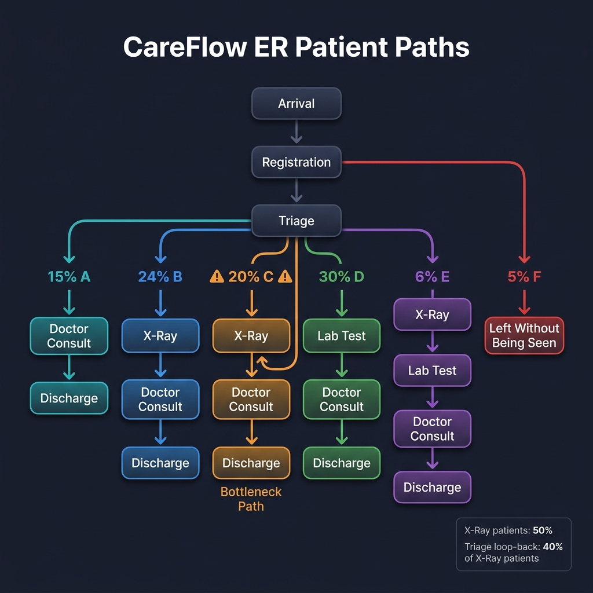

# CareFlow Data Design

## Activities
- Arrival
- Registration
- Triage
- X-Ray
- Lab Test
- Doctor Consult
- Discharge
- Left Without Being Seen *(optional — used by Path F)*

## Paths

### Core paths

| Path | Sequence | % of patients |
|------|----------|---------------|
| A | Arrival → Registration → Triage → Doctor Consult → Discharge | 15 |
| B | Arrival → Registration → Triage → X-Ray → Doctor Consult → Discharge | 24 |
| C | Arrival → Registration → Triage → X-Ray → Triage → Doctor Consult → Discharge | 20 |
| D | Arrival → Registration → Triage → Lab Test → Doctor Consult → Discharge | 30 |

### Optional paths (for spaghetti-diagram realism)

| Path | Sequence | % of patients |
|------|----------|---------------|
| E | Arrival → Registration → Triage → X-Ray → Lab Test → Doctor Consult → Discharge | 6 |
| F | Arrival → Registration → Left Without Being Seen | 5 |

**Total: 100%**

### Math check

| Rule | Calculation | Result |
|------|-------------|--------|
| All paths sum to 100 | 15 + 24 + 20 + 30 + 6 + 5 | **100 ✓** |
| X-Ray patients (B + C + E) | 24 + 20 + 6 | **50 (50% of all patients)** |
| C = 40% of X-Ray patients | 40% × 50 | **20 ✓** |
| B + E = 60% of X-Ray patients | 60% × 50 | **30 (24 + 6) ✓** |

### Design rationale

- **D is the largest single path (30%)** — lab tests are the most common diagnostic in a real ER.
- **B + C + E = 50%** — about half of ER patients need imaging, which feels realistic.
- **A = 15%** — a smaller group with minor complaints that go straight to the doctor after triage.
- **E = 6%** — a small subset needs both X-Ray and Lab Test (e.g., trauma + blood work).
- **F = 5%** — patients who leave before being seen (a well-documented ER phenomenon, adds a realistic "drop-off" to the spaghetti diagram).